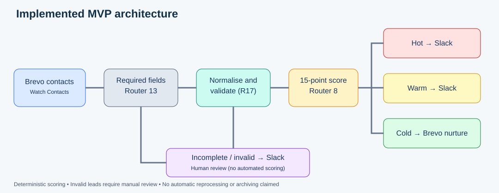

# AI Lead Qualification & Sales Routing Agent

**Business Analysis · Workflow Automation · System Integration · UAT**

**Status:** Implemented and UAT-tested portfolio MVP, using a **simulated B2B scenario** (not a production client deployment).

## The business problem
Manual B2B lead qualification can delay follow-up and lead to inconsistent prioritisation. I analysed the simulated process, designed its TO-BE state and built a workflow that checks lead quality, applies transparent business rules and routes leads to the appropriate destination.

## My contributions
- **Business Analysis:** AS-IS and TO-BE process mapping, requirements, MoSCoW, user stories, acceptance criteria and traceability.
- **Automation engineering:** Built a Make scenario integrating Brevo contact intake with Slack sales alerts and Brevo nurture lists.
- **Quality assurance:** Tested normal, negative and boundary scenarios; identified a scoring defect; implemented a validation gate and regression-tested the correction.
- **Exception handling:** Sent missing or unrecognised inputs for manual review and tested downstream retry/retention behaviour.

## Implemented workflow
1. Brevo Watch Contacts triggers the Make scenario (scheduled every 15 minutes in the MVP).
2. Router 13 checks whether required qualification fields are present.
3. Complete leads are normalised, and Router 17 verifies recognised scoring values.
4. Valid leads receive a deterministic **15-point score** from company size, budget and purchase timeline.
5. **Hot (11–15):** Slack `#hot-leads`; **Warm (6–10):** Slack `#warm-leads`; **Cold (0–5):** Brevo `Cold Leads - Nurture`.
6. Incomplete or invalid leads are sent to Slack `#incomplete-leads` for manual review.
7. A controlled Slack failure test produced three retry attempts and a retained **Unresolved** execution.

## UAT highlight: finding and fixing a defect
An unrecognised company-size value (`Unknown`) initially contributed zero, allowing a lead to be incorrectly classified **Warm with score 6**. I traced this to a missing pre-scoring validation check, added Router 17 and regression-tested that invalid leads were blocked from scoring and sent for review.

| Evidence | Test | Observed result |
|---|---|---|
| E01 | Complete Make workflow | Integrated scenario configured |
| E02 | Hot boundary score 11 | Hot Slack routing |
| E03 | Warm boundaries 6 and 10 | Warm Slack routing |
| E04 | Cold lead | Brevo nurture routing |
| E05 | Missing required data | Manual review |
| E06 | Unrecognised scoring input | Blocked; manual review |
| E07 | Downstream Slack failure | Three attempts; Unresolved execution |

The underlying screenshots are **not published** until identifiers and personal data are reviewed/redacted.

## Documentation
- [Business Analysis](docs/business-analysis.md)
- [Architecture](docs/architecture.md)
- [Scoring rules](docs/scoring-rules.md)
- [UAT and remediation](docs/uat-summary.md)
- [Recruiter-facing case study](docs/case-study.md)
- [Evidence index](evidence/README.md)
- [Public publishing checklist](docs/publishing-checklist.md)

## Business value and limitations
The MVP demonstrates consistent, explainable routing and exception safeguards. **No verified production time savings, revenue uplift or volume benchmark is claimed.** A consolidated audit store, load testing and production security/monitoring reviews remain deferred.

**AI disclosure:** The implemented scoring and routing use **deterministic business rules**, not autonomous LLM scoring. The project name is a portfolio label rather than a claim of deployed generative AI.

## Demonstration
A video is optional. The written case study, architecture, requirements and UAT documentation explain the implementation.

## Related project
[YouTube Comment Intelligence Agent](https://github.com/michaeloluwaleye/youtube-comment-intelligence-agent) — a separate AI-agent automation portfolio project.

## Author
[Michael Oluwaleye](https://github.com/michaeloluwaleye)
